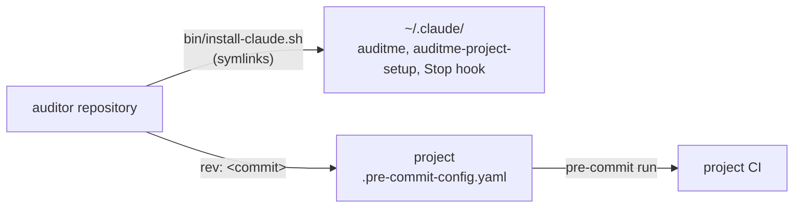

# How it works

The repository has two consumers: each project's pre-commit and CI, which run the checker pinned to a
commit of this repository, and Claude Code on your machine, which runs the Stop hook from `~/.claude/`.



## The checker in a project

The checker is the `auditor` package (`src/auditor/`), installed as the `auditor` command: Python with no dependencies outside the
standard library, plus `ruff` and `uv` for the hygiene checks and `git` for the commit hook's diff. A project pins it through
`.pre-commit-hooks.yaml`:

| Where | Hook | Scope | Fails on |
|---|---|---|---|
| `git commit` | `auditme-changed` | the whole tree is swept, hits are reported for files changed on the branch (`<base>...HEAD`) or in the index or working tree; the sweep is skipped when no diff base resolves or no reportable file changed | an unaccepted hit in a changed file, or in a file a cross-file hit links to one; or a failure: git cannot run, a git diff or `rev-parse` fails, the repository root cannot be resolved, or the sweep cannot start, times out, exits non-zero, prints a line that is not a hit or reports a crashed check |
| `git push` | `auditme-all` (a `manual`-stage hook: the project's config adds `pre-push` to run it at push) | the whole tree | any unaccepted hit |
| CI | `auditme-all` | the whole tree | any unaccepted hit |

The commit hook ignores hits in files you did not touch, so an old hit never blocks an unrelated
commit. The push gate and CI catch what the commit hook cannot see: a hit that appears without its
file changing, such as a duplicate of code added elsewhere.

A hit you have judged correct to keep is accepted in the code, beside the hit, with the reason:

```python
# auditme: accept[<rule>] <reason>
```

The reason stays in the source, where the next reader of that line sees it. See
[The audit checker](guide/checker.md) for the rules and the marker's exact placement.

## Pinning and upgrades

Projects pin the hooks with `rev:` to a commit of this repository. A new rule therefore fails no build
until a project upgrades with `pre-commit autoupdate`, and the upgrade commit fixes or accepts the new
hits in the same change. This repository runs its own hooks from its working tree (`repo: local`), so a
checker change applies in the commit that makes it.

A project that adopted the hooks before the checker moved here still pins `bnomis/agents`. That pin
keeps working, because the agents commits it names still hold the checker; see
[Moving a project from agents](setup.md#moving-a-project-from-agents).

## Rules repositories and trust

The checks and the Phase B questions can live in a separate rules repository
that `AUDITOR_RULES_PATH` names. The runner (`auditor check`, `auditor phaseb`)
loads it and runs what it holds: each rule is a directory with a `rule.md` and a
`rule.toml`, and `auditor-rules.toml` at the root names the helper API version
the repository was written for. `auditor rules` reports on it
([commands](reference/cli.md#auditor-rules)).

**A rules repository is trusted code.** `auditor check` imports and runs Python
from it, in the same way a project's own `conftest.py` runs under pytest. The
runner loads a rules repository only from `AUDITOR_RULES_PATH`, never from a
path the audited project names, so auditing a project cannot make the runner
run that project's code as rules. Point the variable only at a repository you
trust. See [setup](setup.md#pointing-the-runner-at-a-rules-repository).

## The Stop hook

`bin/install-claude.sh` also registers `claude/hooks/auditme-stop.sh` as a Claude Code Stop hook in
`~/.claude/settings.json`. In a project whose `.pre-commit-config.yaml` contains `id: auditme-changed`,
it runs the checker over the changed files when Claude ends a turn, and sends the hits back once, so
Claude fixes them before handing over. Elsewhere it does nothing.

The Stop hook runs the checker from your clone, not the project's pinned revision, so it is an early
warning; the pinned hooks remain the authority.
