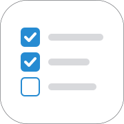

# auditor

{ align=right width="128" }

`auditme`, a static checker that projects pin as pre-commit hooks so the rules a script can check
are enforced on every commit, push and CI run, together with the Claude Code Stop hook that runs it
before a turn ends and the `/auditme-project-setup` skill that adopts the hooks in a project. The rules the
checker enforces, and every other shared skill, live in the agents repository
([`bnomis/agents`](https://bnomis.github.io/agents/)).

```shell
git clone git@github.com:bnomis/auditor.git ~/src/auditor
~/src/auditor/bin/install-claude.py
```

The installer links the `/auditme` and `/auditme-project-setup` skills and the Stop hook into `~/.claude/`,
and registers the Stop hook. A project then opts in to the checker with `/auditme-project-setup new` or
`/auditme-project-setup adopt`, which pins the hooks in its `.pre-commit-config.yaml`:

```yaml
- repo: git@github.com:bnomis/auditor.git
  rev: <commit>
  hooks:
    - id: auditme-changed
    - id: auditme-all
      stages: [manual, pre-push]
```

## What is in the repository

| Path | What it is |
|---|---|
| `claude/skills/auditme/checks/` | The checker: a standard-library-only sweep over `src/` and `bin/`. See [The audit checker](guide/checker.md). |
| `claude/skills/auditme/` | The `/auditme` skill: the sweep, then the interpretive review. See [Skills](reference/skills.md). |
| `claude/skills/auditme-project-setup/` | The `/auditme-project-setup` skill and its templates. See [Skills](reference/skills.md). |
| `claude/hooks/` | The Claude Code Stop hook that runs the checker before a turn ends. |
| `bin/install-claude.py` | The installer. See [Command line and hooks](reference/cli.md). |
| `.pre-commit-hooks.yaml` | The hooks other projects pin. |

## Where to start

1. Read [How it works](concepts.md) for the moving parts and why each is where it is.
2. Follow [Setting up](setup.md) for a new machine, a new project or an existing one, or to move a
   project that still pins `bnomis/agents`.
3. Read [The audit checker](guide/checker.md) before the first hit appears: what it sweeps, how to
   read a hit and how to accept one.
4. Look things up in the reference: [Skills](reference/skills.md) and
   [Command line and hooks](reference/cli.md).

## Why

- **A rule a script can check is a hook.** A rule that lives only in prose drifts; the checker turns
  each mechanical rule into a failing commit, so the drift never reaches an audit.
- **The commit sees your changes; the push sees everything.** The commit hook reports hits only in the
  files a commit changes, so nobody is blocked by someone else's old hit; the push gate and CI sweep the
  whole tree.
- **Projects choose when to upgrade.** Each project pins the checker to a commit of this repository, so
  a new rule fails a build only after `pre-commit autoupdate`.
